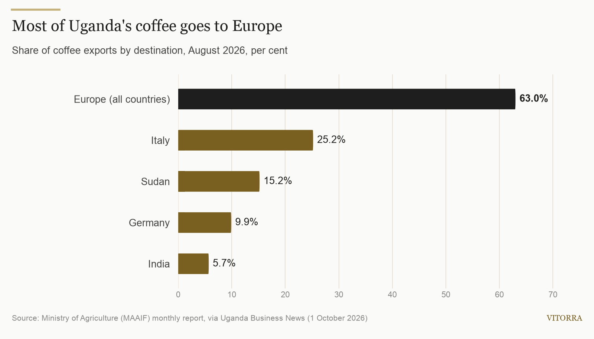
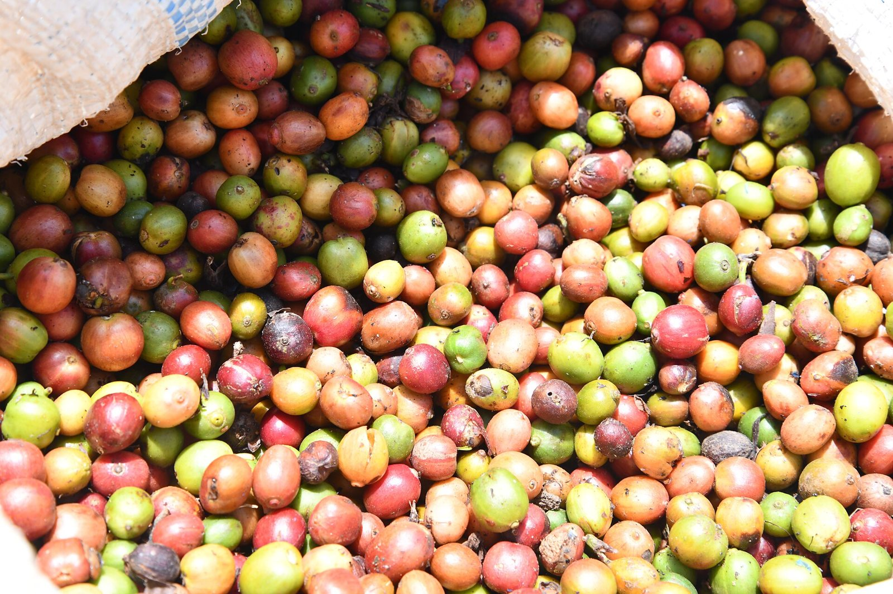
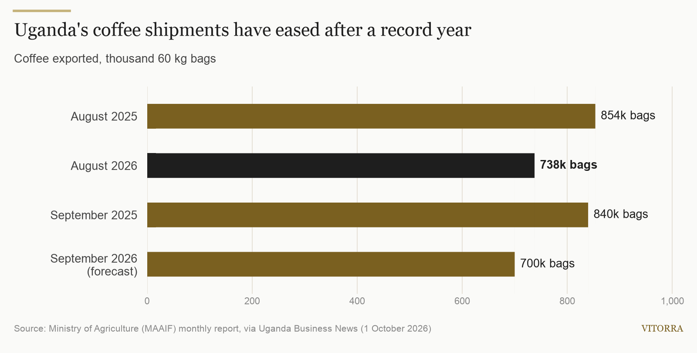

TITLE: EU deforestation rules start on 30 December: what Ugandan coffee exporters and buyers need ready
SLUG: eu-deforestation-rules-uganda-coffee-30-december
EXCERPT: Europe takes most of Uganda's coffee, and from 30 December 2026 every bag sold there must be shown to be deforestation-free. Here is what the rules ask for, where Uganda's trade stands, and what to do in the next nine weeks.
COVER IMAGE: images/2026-10-27-coffee-farm.jpg
SEO TITLE: EUDR and Uganda Coffee: What to Have Ready by 30 December
SEO DESCRIPTION: The EU deforestation regulation applies to coffee from 30 December 2026. What Ugandan exporters and buyers must have ready, and why it matters.
TOPIC: coffee
---
In nine weeks, the rules for selling coffee into Europe change. From 30 December 2026, the European Union's deforestation regulation, usually called the EUDR, applies to coffee. Any coffee placed on the EU market from that date must be shown to be deforestation-free and produced in line with the laws of the country where it was grown.

For Uganda this is not a side issue. Europe took 63% of the country's coffee shipments in August, according to the Ministry of Agriculture's monthly report. Italy alone took a quarter, and Germany almost a tenth.

## The date is now fixed

The EUDR has been postponed twice. In December 2025 the EU adopted an amended text, Regulation (EU) 2025/2650, which gave companies one more year. In its May 2026 report to the European Parliament and Council, the European Commission confirmed that the regulation enters into application on 30 December 2026 for all companies except most micro and small operators, which have until 30 June 2027.

Coffee buyers in Europe are not planning for another delay, and Ugandan exporters should not either.

## What the rules ask for

The regulation covers seven commodities, coffee among them. To sell coffee in the EU, the company that first places it on the market must file a due diligence statement in the EU's information system. Under the amended text, that obligation sits with the first operator; buyers further down the chain keep the reference number of that original statement.

In practice, the European importer files the statement, but it can only do so with information that starts at origin: where the coffee was grown, evidence that the land was not deforested, and evidence that it was produced legally. That information has to travel with each lot from the farm to the port.

The scope may also widen. The Commission has proposed adding soluble (instant) coffee to the products covered, so processed coffee would need the same evidence as green beans.

*Photo: Denis Kasozi, [CC BY-SA 4.0](https://creativecommons.org/licenses/by-sa/4.0/), via [Wikimedia Commons](https://commons.wikimedia.org/wiki/File:Harvested_Ugandan_coffee_1.jpg)*

## Where Uganda's coffee trade stands

The timing comes as shipments ease after an exceptional year. Uganda exported 737,766 bags of 60 kg in August, down 13.6% from 853,543 bags a year earlier, and worth $181.7 million. Agriculture Minister Frank Tumwebaze attributed lower output to drought and high temperatures in parts of Greater Masaka, Kyotera, Sembabule and Luwero. The ministry expects about 700,000 bags in September, against 839,801 in September 2025.

Prices have cushioned the fall. The average export price rose to $4.1 a kilogram in August. Robusta made up 92% of the volume, while Arabica fetched $6.0 a kilogram on average, and Mt Elgon grades reached $7.9. The International Coffee Organization described the decline as a likely return to normal after a record 2024/25 year of 8.26 million bags. Over the 12 months to August, Uganda exported 8.1 million bags worth $2.1 billion.

With volumes tighter, European buyers will favour supply they can document. A lot that arrives without the evidence an importer needs is a lot that importer cannot sell in the EU.

## What to have ready before 30 December

For exporters and their suppliers:

1. **Know where every lot comes from.** Record the location of the farms behind each consignment, and keep that record with the lot.
2. **Keep documented coffee separate.** Coffee that can be traced to mapped farms loses its value if it is mixed with coffee that cannot.
3. **Gather legality evidence now.** Land, trade and export records take time to collect; do not leave them until the shipping window.
4. **Ask your buyers what they need.** Importers file the statement, so agree the data format and how it will be handed over before the next contract is signed.
5. **Check contracts that run past 30 December.** Shipments arriving after that date fall under the new rules, whenever they were sold.

For international buyers of Ugandan coffee, the question to put to every supplier is simple: can you give us the farm locations and legality evidence for this lot, in the form our importer needs?

That is how we approach [Vitorra Coffee](/products/coffee), our Ugandan Arabica for export buyers. If you are sourcing for the EU market, [tell us what documentation your importer requires](/enquire?sector=COFFEE) and we will confirm what we can provide for each lot.

## What to watch

- **The Commission's information system,** which is being updated in stages ahead of the deadline.
- **The soluble coffee proposal,** and the date any new products would be covered from.
- **September's export figures,** which will show whether the drought-hit harvest holds near the 700,000-bag forecast.

## Sources

- [European Commission: Report to the Council and Parliament on the EUDR (4 May 2026)](https://environment.ec.europa.eu/document/download/a3c5c3a0-232e-43c4-b0b8-1eecb1df45c7_en?filename=Report+from+the+Commission+to+the+Council+and+Parliament+on+the+EUDR.pdf)
- [European Commission, Access2Markets: Delay until December 2026 and other developments in the implementation of the EUDR (28 January 2026)](https://trade.ec.europa.eu/access-to-markets/en/news/delay-until-december-2026-and-other-developments-implementation-eudr-regulation)
- [EU Green Forum: Deforestation regulation implementation](https://green-forum.ec.europa.eu/nature-and-biodiversity/deforestation-regulation-implementation_en)
- [Uganda Business News: Firmer prices cushion fall in Uganda's August coffee exports (1 October 2026)](https://ugbusiness.com/2026/10/economy/commodities/firmer-prices-cushion-fall-in-ugandas-august-coffee-exports)

*Cover photo: Kateregga1, [CC BY-SA 4.0](https://creativecommons.org/licenses/by-sa/4.0/), via [Wikimedia Commons](https://commons.wikimedia.org/wiki/File:Coffee_and_banana_plantation_in_Uganda.jpg)*
