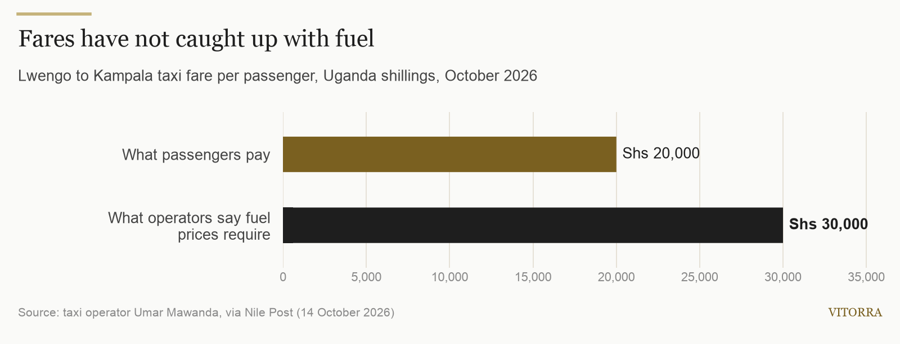
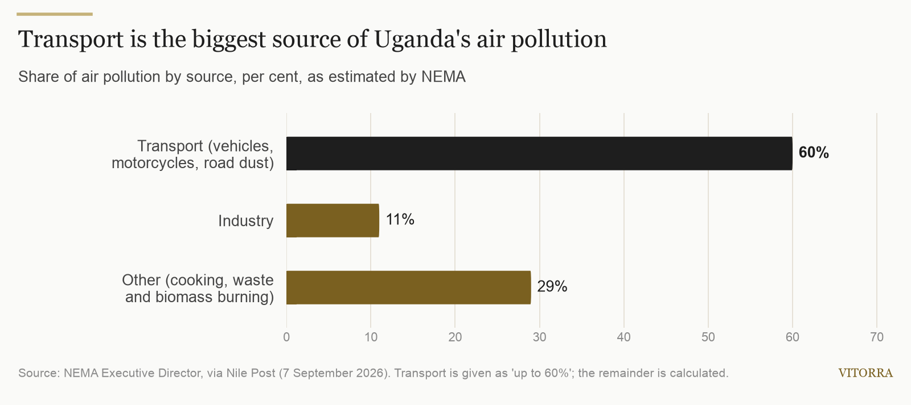
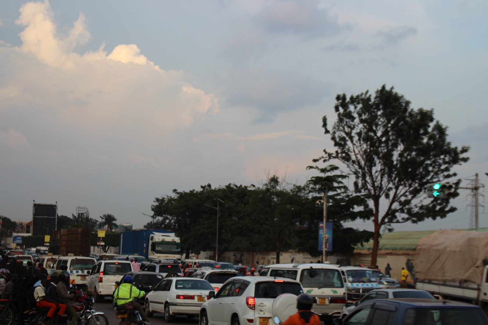

TITLE: Every litre now counts twice: fuel costs, cleaner air and Uganda's transport operators
SLUG: every-litre-counts-twice-fuel-costs-cleaner-vehicles-uganda
EXCERPT: Operators upcountry are parking vehicles because fares no longer cover fuel, while NEMA says transport causes up to 60% of Uganda's air pollution. Why the two pressures point the same way, and what fleet owners can do now.
COVER IMAGE: images/2026-10-27-kampala-taxi-park.jpg
SEO TITLE: Fuel Costs and Cleaner Air: What Uganda's Transport Operators Can Do
SEO DESCRIPTION: Fares lag fuel prices and NEMA plans vehicle emission testing. Why burning less fuel answers both, and practical steps for Ugandan fleet owners.
TOPIC: fet
---
In Lwengo this month, some vehicle owners have simply stopped driving. Visiting the district's fuel stations on 14 October, the Nile Post found diesel selling at between Shs6,950 and Shs7,119 a litre. Local operators told the paper that more owners were parking their vehicles because they could no longer cover their daily costs, and some drivers were buying fuel in small amounts or suspending work altogether.

The problem is the gap between what fuel costs and what customers will pay. Taxi operator Umar Mawanda said that at current fuel prices the fare from Lwengo to Kampala should be Shs30,000, but passengers pay Shs20,000. Farmers and traders feel it too: as transport owners pass on fuel costs, they are left with less money after moving their goods.

## The second pressure: cleaner air

At the same time, Uganda's environment regulator is turning its attention to vehicles. In September, the executive director of the National Environment Management Authority (NEMA), Barirega Akankwasah, said that "up to 60% of our air pollution is accounted for by transport", with vehicles, motorcycles and dust from unpaved roads the main sources. Industry, by comparison, accounts for about 11%.

The rules already exist on paper: the National Environment (Air Quality Standards) Regulations, 2024. NEMA's challenge, he said, is now putting them into practice. The government plans vehicle emission testing and the adoption of Euro 4 emission standards, and NEMA is strengthening enforcement through inspections and a new Environment Protection Force. No start date for vehicle testing has been announced, but the direction is clear.

*Photo: Kyakwera, [CC BY-SA 4.0](https://creativecommons.org/licenses/by-sa/4.0/), via [Wikimedia Commons](https://commons.wikimedia.org/wiki/File:Evening_traffic_jam_setting_in_on_Kampala_road_01.jpg)*

## Why the two pressures point the same way

For a fleet owner, these look like separate problems: one about money, one about regulation. They share a root. A vehicle that burns less fuel to do the same work costs less to run and puts less exhaust into the air.

That is why the same habits answer both. An engine with a clogged air filter or neglected injectors wastes fuel and runs dirtier. A vehicle left idling at a stage or a client's gate burns fuel and pollutes without earning anything. A truck running half-empty does the same.

## What operators can do now

1. **Measure each vehicle.** Record litres and the odometer reading at every fill-up, and work out litres per 100 km. You cannot manage a cost you cannot see, and the vehicles using the most fuel are the first place to look.
2. **Service the engine, not just the paperwork.** On dusty roads, air filters clog quickly. Keep filters and injectors in condition and keep the service records: if vehicle testing arrives, a documented maintenance history will help.
3. **Stop paying for idling.** Agree a simple rule for switching off during long stops, and check it against your fuel log.
4. **Fill the vehicle, not the road.** Combine half-loads and plan return trips, so each litre earns as much as possible.
5. **Price for today's fuel.** Where you can, agree fares and contract rates that reflect current pump prices rather than last year's.

Our [practical guide to reducing fleet fuel costs](/blog/how-to-reduce-fleet-fuel-costs-uganda) covers each of these in more detail.

Once you are measuring, you can also judge fuel-saving technology on your own numbers. [Fuel Eco Tech](/products/fuel-eco-tech) is a device fitted to the fuel line without modifying the engine. In an independent field test in Germany, a Volkswagen T5 van went from 11.52 to 9.92 litres per 100 km, a 13.9% reduction. Because one vehicle is not your fleet, we offer a [free fuel assessment](/enquire?sector=FET) that measures your own vehicles before and after fitting.

## What to watch

- **Vehicle emission testing:** when it starts, which vehicles it covers first, and what the limits are.
- **Euro 4 standards:** how they are applied to new and imported vehicles.
- **Fares and fuel:** whether fares catch up with pump prices, or more operators upcountry park their vehicles.

## Sources

- [Nile Post, via AllAfrica: Fuel prices force Lwengo transport operators to park vehicles as farmers count losses (14 October 2026)](https://allafrica.com/stories/202610150068.html)
- [Nile Post, via AllAfrica: NEMA says transport sector accounts for 60% of air pollution (7 September 2026)](https://allafrica.com/stories/202609080064.html)

*Cover photo: Deepak-nsk, [CC0](https://creativecommons.org/publicdomain/zero/1.0/), via [Wikimedia Commons](https://commons.wikimedia.org/wiki/File:Kampala_old_taxi_park.jpg)*
